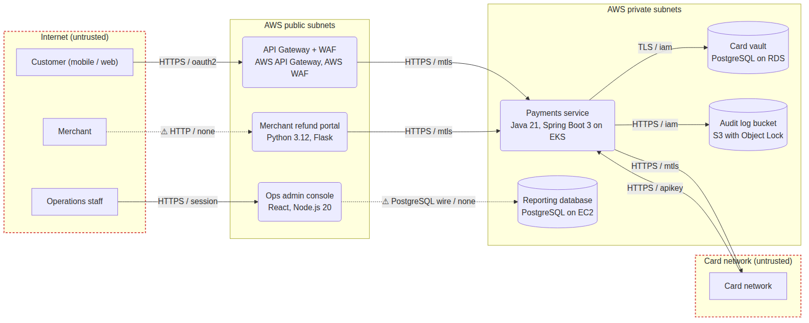

# ArchThreat

**Threat modeling as code.** Describe a system's data flows and trust boundaries in YAML.
ArchThreat applies deterministic STRIDE rules (including rules for LLM components, based on
the OWASP Top 10 for LLM Applications) and can optionally ask an LLM, grounded in retrieved
security guidance, for context-specific threats. It then produces a Mermaid data-flow diagram,
a markdown report, SARIF for GitHub code scanning, and a threat diff comment on every pull
request that changes the architecture.

> **Rules find what must never be missed. The model adds context. Code decides what to keep.**




*Generated from [samples/payments-platform-v2.yaml](samples/payments-platform-v2.yaml): dotted
lines are unencrypted, ⚠ marks an unauthenticated flow across a trust boundary.*

## Why

Threat models are usually a workshop, a diagram and a document that's out of date by the next
sprint. ArchThreat keeps the model in the repository next to the code. The model is validated
in CI, analysed the same way every time, and diffed on every pull request, so the security
consequence of an architecture change shows up where the change is reviewed.

## Quick start (offline, no model)

```bash
git clone https://github.com/taani07/archthreat && cd archthreat
python3 -m venv .venv && source .venv/bin/activate && pip install -e ".[dev]"

archthreat analyze samples/rag-assistant.yaml
archthreat report samples/payments-platform.yaml --out threat-model.md
archthreat diff samples/payments-platform.yaml samples/payments-platform-v2.yaml
```

```
$ archthreat analyze samples/rag-assistant.yaml
critical tampering              orchestrator      LLM-001    Prompt injection can steer LLM orchestrator
high     tampering              ingest_job        INPUT-001  Untrusted input to Web ingestion job is not validated
high     elevation_of_privilege orchestrator      LLM-002    LLM orchestrator can act through create_ticket, send_email without a human decision
high     information_disclosure orchestrator      LLM-003    LLM orchestrator can disclose restricted data to users who should not see it
medium   repudiation            orchestrator      AUDIT-001  Actions in LLM orchestrator on sensitive data cannot be attributed
medium   denial_of_service      orchestrator      LLM-004    Cost and capacity of LLM orchestrator can be exhausted
```

The orchestrator never talks to the internet, yet it's flagged for prompt injection. Public
web pages reach it through ingest job, then vector store, then orchestrator. ArchThreat finds
that path with a reachability search over the data flows. That's indirect prompt injection,
and it's easy to miss on a whiteboard.

## The model

```yaml
system: Payments platform
trust_boundaries:
  - {id: internet, name: Internet, untrusted: true}
  - {id: aws_private, name: AWS private subnets}
components:
  - {id: customer, type: external_entity, boundary: internet}
  - id: payments_service
    type: process                      # external_entity | process | data_store
    boundary: aws_private
    tech: Java 21, Spring Boot 3 on EKS
    input_validation: true             # undeclared security properties count as ABSENT
    audit_logging: true
  - id: card_vault
    type: data_store
    boundary: aws_private
    data_classification: restricted
    encrypted_at_rest: true
flows:
  - {id: f1, source: customer, target: payments_service, authn: oauth2, data: [card_data]}
  - {id: f2, source: payments_service, target: card_vault, authn: iam}
```

Components that use an LLM declare `llm: {agency: none | read | write, tools: [...]}`. Flows where
the target fetches (a job downloading pages) declare `pull: true`; see
[ADR 0002](docs/adr/0002-pull-flows.md) for why that matters.

## Rules

`archthreat rules` lists them: authentication across boundaries, static keys from untrusted
zones, plaintext crossings, unencrypted sensitive stores, missing audit logging, missing rate
limiting, missing input validation, root processes, exposed admin interfaces, and four LLM
rules: prompt injection (LLM01), excessive agency (LLM06), sensitive data access (LLM02) and
unbounded consumption (LLM10). Each threat carries likelihood and impact (a 3x3 matrix sets the
severity), mitigations as a checklist, and CWE or OWASP LLM references.

## LLM enrichment (optional)

```bash
export LLM_PROVIDER=ollama   # or anthropic, bedrock
archthreat analyze samples/payments-platform.yaml --llm
```

For each process and data store, the model sees the element, its flows, the threats already
found and retrieved guidance, and proposes new threats. Code then drops proposals with a STRIDE
category that doesn't apply to the element type, malformed references and near-duplicates,
and caps the count. Accepted threats are labelled model-generated. `archthreat extract notes.md`
drafts a model from prose, and the model's own validation errors drive the repair loop.

## Outputs and integrations

| Command | Output |
| --- | --- |
| `report` | Markdown with the Mermaid DFD, a STRIDE x severity summary, and mitigation checklists |
| `diagram` | Mermaid only |
| `diff A B [--fail-on-new high]` | PR comment: architecture changes, new and resolved threats |
| `sarif` | SARIF 2.1.0, located at the element's line in the YAML, with stable fingerprints |
| `export-assets` | Asset context for [VulnLens](https://github.com/taani07/vulnlens) (exposure, data classification) |
| `serve` / `mcp` | REST API, and an MCP server for Claude Desktop or Claude Code |

- [.github/workflows/threat-model-pr.yml](.github/workflows/threat-model-pr.yml) comments the
  diff on PRs that touch `threatmodels/` and fails on new high or critical threats.
- [ci.yml](.github/workflows/ci.yml) uploads this repository's own threat model
  ([threatmodels/archthreat-service.yaml](threatmodels/archthreat-service.yaml)) to code
  scanning. It flags, among others, that user-submitted YAML reaches the enrichment prompt. That
  finding is real, and it's why model text is fenced as untrusted.

## Evals

`archthreat eval` checks [evals/golden.yaml](evals/golden.yaml): 19 threats that must be found
and 12 plausible false positives that must not be raised, across four models. Both must score
1.0 in CI. `--llm` adds acceptance, duplicate and violation rates for the model. See
[docs/EVALS.md](docs/EVALS.md).

## Learn by rebuilding it

[labs/](labs/README.md) has 8 guided labs (model validation, graph reachability, STRIDE rules,
diagram generation, validating LLM output, diffs, SARIF, PR workflow), each with a starter file
and tests. They pair with the 12 labs in VulnLens; the combined 4-week plan is in
[VulnLens docs/LEARNING_PATH.md](https://github.com/taani07/vulnlens/blob/main/docs/LEARNING_PATH.md).

## Honest notes

- Rules can only see what the model declares. A wrong model gives a wrong analysis; that's why
  undeclared controls count as absent and why diffs go through code review.
- LLM-generated threats are suggestions, labelled as such, and excluded from CI gates.
- Independent learning and portfolio project using public frameworks (STRIDE, OWASP, MITRE
  CWE); not affiliated with any employer.

## License

MIT
