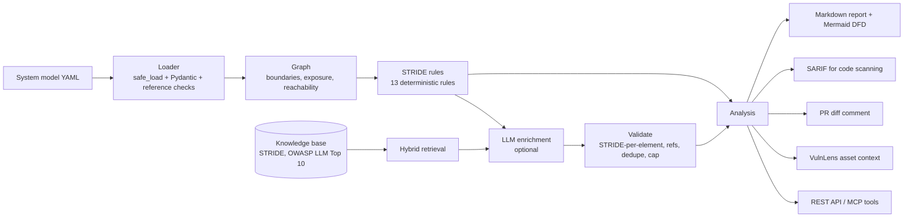

# Architecture

| Module | Responsibility |
| --- | --- |
| `models.py` | System model, threats, 3x3 risk matrix, stable threat keys |
| `loader.py` | YAML loading with `safe_load`, size limit, readable validation errors |
| `graph.py` | Boundary crossing, internet-facing vs receives-untrusted-data, BFS reachability, data sensitivity |
| `rules.py` | STRIDE-per-element table and 13 targeted rules (incl. four for LLM components) |
| `enrich.py` | RAG-grounded LLM proposals and the checks that decide what to keep |
| `extract.py` | Draft a model from prose; the model's own validator drives the repair loop |
| `diagram.py`, `report.py` | Mermaid DFD and markdown report |
| `diff.py` | Architecture and threat deltas for pull requests |
| `sarif.py` | SARIF 2.1.0 export with line locations and fingerprints |
| `export.py` | Asset context for VulnLens |
| `llm/`, `rag/` | Shared with VulnLens: provider interface and hybrid retrieval |
